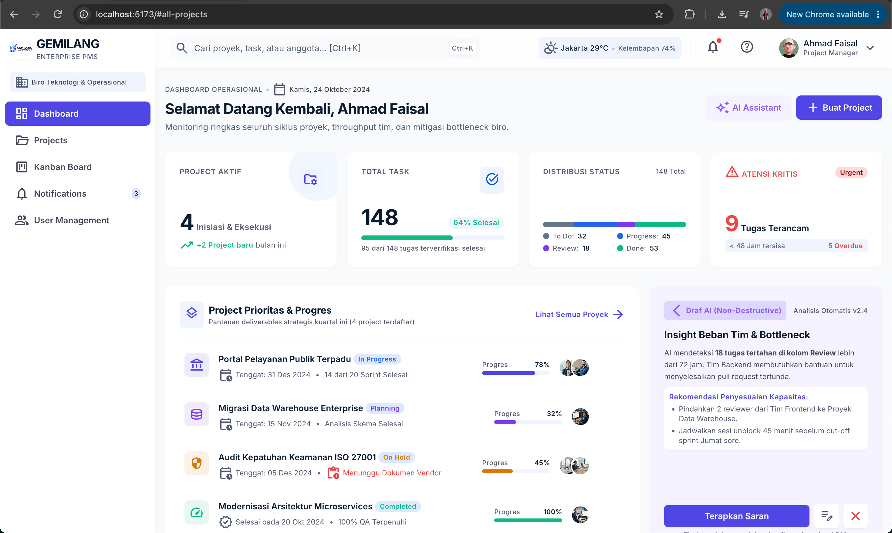

# GEMILANG — TeamFlow

Aplikasi manajemen proyek dan kolaborasi tim berbasis web untuk membantu mengelola proyek, tugas, deadline, dan progres pekerjaan secara terstruktur.

## 🖥️ Application Preview

Berikut adalah hasil render UI aplikasi GEMILANG:



## ✨ Features

- Project Management
- Task Management
- Deadline Tracking
- Team Collaboration
- Project Progress Dashboard

## 🛠️ Tech Stack

- Frontend: React
- Backend: NestJS
- Authentication: JWT
- Communication: AJAX
- AI Integration
- Deployment: Web Deployment

## 📂 Project Structure

```text
GEMILANG/
├── gemilang-frontend/
│   └── public/
│       └── images/
│           └── screenshot/
│               └── satu.png
├── README.md
└── ...
```

## 🚀 Getting Started

Clone repository:

```bash
git clone <repository-url>
cd <project-directory>
```

Install dependencies:

```bash
cd gemilang-frontend
npm install
```

Run the development server:

```bash
npm run dev
```

## 👨‍💻 Development

GEMILANG TeamFlow dikembangkan sebagai proyek untuk mendukung pengelolaan proyek, pembagian tugas, dan pemantauan progres kerja tim.
